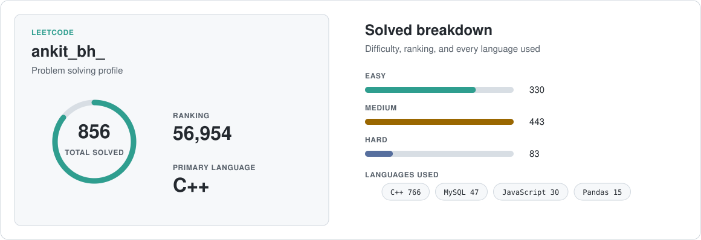

<h1 align="center">Ankit Bhardwaj</h1>

  <strong>Software Engineering Intern at Wyrd Media Labs</strong> 
  Creative technologist working across full-stack engineering, automation, applied AI, and thoughtful interface design.

  
  
  
  
  
  
  

---

## A little about me

Some engineers begin with code. I began with **signals, control systems, and the question of how complex things behave**.

My background in **Instrumentation & Control Engineering at NSUT** still shapes the way I build software. I look for structure, feedback, failure modes, and the clearest path from an idea to a dependable system.

That curiosity has never been limited to machines. I am equally fascinated by **living systems**, especially how they sense, adapt, communicate, organise, and respond to change. To me, biology, software, intelligent systems, and design are not separate interests. They are different ways of understanding how many interacting parts become something coherent.

Today, I work across full-stack platforms, third-party integrations, workflow automation, and applied AI at **Wyrd Media Labs**. I enjoy turning ambiguous ideas into software that feels clear, deliberate, and useful. Strong engineering is not only about making something work. It is also about how naturally the system fits together and how thoughtfully it meets the person using it.

  
  
  
  

## Code & problem solving

  <a href="https://leetcode.com/u/ankit_bh_/">
    <picture>
      <source media="(prefers-color-scheme: dark)" srcset="assets/leetcode-card-dark.svg" />
      <source media="(prefers-color-scheme: light)" srcset="assets/leetcode-card-light.svg" />
      
    </picture>
  </a>

  I primarily solve in <strong>C++</strong>, with a focus on graphs, dynamic programming, trees, and system-oriented problem solving.

## Tools I reach for

  

  <em>Sketching, painting, visual design, basketball, and singing keep me connected to rhythm, movement, composition, and expression.</em>

---

## Let's connect

I enjoy exchanging ideas with developers, researchers, designers, and people building thoughtful products. If you're working on something interesting, want to discuss engineering or research, or see an opportunity to collaborate, feel free to reach out.

**[LinkedIn](https://www.linkedin.com/in/ankit-bhardwaj-6b9b62221/)** · **[Medium](https://medium.com/@ankitbhardwaj80100)** · **[Instagram](https://www.instagram.com/ankit.bh_/)** · **[LeetCode](https://leetcode.com/u/ankit_bh_/)** · **[ORCID](https://orcid.org/0009-0005-3408-0058)** · **[Email](mailto:ankitbhardwaj80100@gmail.com)**
